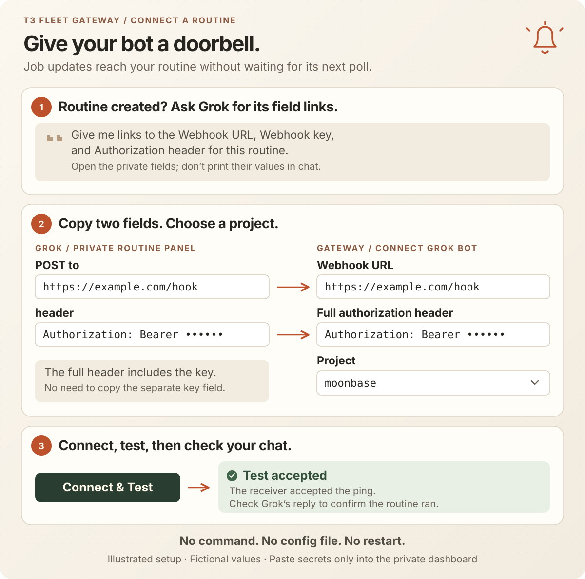
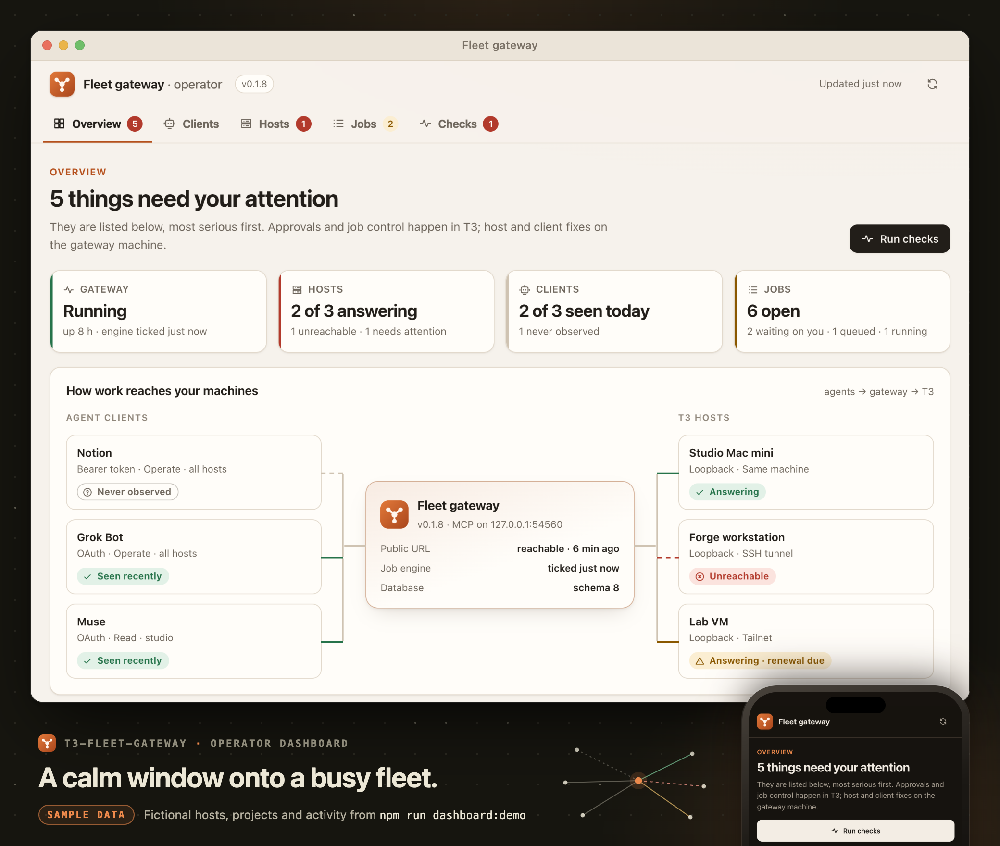

# t3-fleet-gateway

[](https://github.com/boundsj/t3-fleet-gateway/actions/workflows/check.yml)

Ask your bot to get something done. Let [T3 Code](https://github.com/pingdotgg/t3code) do the coding on your machines.

T3 Fleet Gateway connects Grok Bot, Notion and other MCP clients to your T3 servers through one connection. Your agent can find projects, start work, answer worker questions and bring back the result. Each new job gets a T3 thread you can open in T3 whenever you want: a named project's job gets its own git worktree and branch, and work with no named project can run in a machine's T3 scratch workspace.



- **One connection for the fleet.** Add machines behind the gateway without adding an MCP connection to every bot.
- **Work you can follow.** Jobs have stable IDs, readable replies and a feed of changes that survives restarts.
- **Access you choose.** Give an agent Read or Operate access to all machines or selected ones. Project rules decide what its workers may do.
- **Updates when work changes.** Webhooks wake your bot when a turn finishes or a job needs attention.

## Get going with prompts

You need an always-on machine with Node.js 24.22.1+ on 24.x or 26.12.1+ (older releases do not block the [compromised eMudhra intermediates](docs/security.md#compromised-emudhra-intermediates)), a running T3 Code server and its `t3` CLI. A coding agent on that machine can do the setup. The gateway runs from a Git checkout; it is not published to npm.

### 1. Ask your coding agent to set up the gateway

```text
Set up https://github.com/boundsj/t3-fleet-gateway on this machine.
Follow docs/setup.md and docs/operations.md. Use a dedicated service
checkout, enroll this machine's T3 server, and add these project
aliases: <your projects>.

Use <your HTTPS tunnel> for the public MCP connection. Enable the
dashboard on a private tailnet URL, separate from the public MCP
listener. Keep discovery off and project approval settings at their
defaults. Run doctor, then give me the MCP URL and dashboard URL.
```

> **What this does:** gives your cloud agent a secure way to reach T3 while keeping the operator dashboard private. The gateway handles T3 credential renewal after enrollment.

Prefer doing it yourself? The same steps are in the [manual setup guide](docs/setup.md).

### 2. Connect your bot

Add the returned `/mcp` URL as a remote MCP connection in Grok Bot or your chosen client. For OAuth clients, ask the setup agent to mint a one-time approval code. Enter it on the gateway's approval page, choose **Read** or **Operate**, and select the machines.

> **Pick the right access:** Read follows work; Operate also starts and steers it. All machines includes hosts you add later. Selected machines stays limited to those you approve.

If your client only accepts a bearer token, as Notion's custom MCP connections do, ask the setup agent:

```text
Create a gateway bearer token for <client name>, with <read or operate>
access to <host IDs> and a 90-day expiry. Help me enter it privately in
the client's connection settings. Do not put the token in chat.
```

Once connected, tell your bot:

```text
Call fleet_status and tell me which machines and projects you can use.
When I give you work, use the gateway to start or continue the right
job. Follow its status, read the worker's replies, and tell me when it
is ready for review or needs my help. Keep the job ID and T3 link.
```

### 3. Give it a small job

```text
In project <alias>, check the README for broken local links and propose
the smallest fix. Run the relevant checks and bring me the result for
review. Don't merge or deploy it.
```

> **What happens next:** the gateway starts a T3 thread in a fresh worktree, tracks it, and lets your bot read the result. Worker questions can come back through the bot. Permission approvals still need your click in T3; [unattended projects](docs/configuration.md#approvals-and-unattended-projects) can use a different runtime mode.

## Settle finished work

When review is complete, your bot can call `work_settle({ jobId, requestId })` with a unique request ID. It needs Operate access. The job must be idle, cancelled, failed or released, with no running turn, queued user messages or active delegated work. The gateway checks T3 first and confirms settlement by reading it back. `work_status` reports `settled` and `settledAt`; `work_feed` emits `thread_settled`.

Settling parks the thread, clears its pin, ends PR watches and detaches provider sessions. It does not archive the thread or change the job state. `work_continue` can resume a settled idle job; T3 clears settlement when it accepts the message. Terminal jobs keep their existing behavior. If the host credential cannot settle the thread, the tool returns `t3_unauthorized`; ask the operator to review its T3 access. [Settlement checks, retry rules and bounds](docs/design.md#thread-settlement).

## Give your bot a doorbell 🔔

A webhook tells your bot that something changed, so it can check the job without waiting for its next scheduled poll. The gateway sends a small notification; the bot uses its existing MCP connection to read the details.



### 1. Create the routine in Grok Bot

In the bot conversation you want to receive updates, try:

```text
Create a webhook-triggered routine for T3 gateway updates. For type
"ping", acknowledge the connection test; it has no job ID. For job
events, deduplicate by eventId, call work_status for jobId, and read
work_messages when needed. Report a short status update here.

For this first test, only report: don't start, change or cancel work.
If waitingOnDelegatedWork is true, say the coordinator is still waiting
on its helpers. Keep scheduled work_feed catch-up as a fallback.

Give me the clickable Webhook URL, Webhook key and Authorization header
links that open this routine's private fields. Do not print the actual
URL, key or header value in chat.
```

### 2. Copy the routine's connection details

Use the links Grok supplies to open the routine's private fields. If the routine list doesn't show them, ask Grok for those links explicitly. In the routine panel, copy **POST to** into the gateway's **Webhook URL** field, and **header** into **Full authorization header**. The full header already contains the key; you don't need to copy the separate **key** field.

Paste both values directly into **Connect Grok Bot** on the private gateway dashboard, then choose the project to follow. Keep them out of chats.

### 3. Click Connect & Test

The gateway tests the connection, saves it privately and starts delivering updates. No terminal commands, JSON editing or service restart. Use **Replace key** to update the connection details, **Send test** to try again, or **Disconnect** to stop delivery.

If you recreate the routine or rotate its credentials, copy both fields again: the **POST to** URL can change along with the key.

> **What success means:** “Test accepted” means the receiver accepted the HTTP request. Check your Grok conversation for its reply to confirm that the routine ran. An already-idle job doesn't produce a new event just because you connected.

The default events cover finished turns (`idle`), questions or approvals (`needs_input`), failures, cancellations and delegated work ending. Excerpts are off by default. Delivery may be retried, so routines should deduplicate events and keep feed catch-up enabled. [Delivery and recovery details](docs/design.md#outbound-job-webhooks).

Using another receiver? Generic HTTPS subscriptions support its own authentication header and project, machine and event filters. See [webhook configuration](docs/configuration.md#webhooks). The quick connection flow needs a routine created in Grok first: two pasted fields and one button, rather than automatic account linking.

## See what's happening



*The real dashboard running on a synthetic demo fleet. Names and activity are made up.*

Open your private dashboard to see which machines answer, which agents have connected, and which jobs need you. **Run checks** refreshes health checks. Webhook controls connect your routines; job approvals and control stay in T3.

The dashboard uses a separate loopback listener and belongs behind your private tailnet proxy. Your public MCP URL is for agents. [Dashboard setup and access](docs/operations.md#operator-dashboard).

## Follow a job's pull requests

Ask your bot:

```text
Which PRs came out of that job? Show me what's open and what's merged.
```

`work_status` and `work_list` include cached PR links and states, even for text-only clients: up to 20 per job, open ones first and then the newest. A job follows up to 200 PRs, so a merge among the others is still noticed, and the text says so when it shows only part (`20 of 35 shown`). The dashboard shows a small **PR #21 open** badge beside the job. Workers need to register their PR with T3's `link_pull_request`; a coordinator should link its children's PRs too.

> **What this means:** you can follow the result of a job without searching GitHub. PRs refresh about once a minute while the job is followed, on top of T3's own sync delay. Unknown means not yet readable; a finished or released job keeps its last snapshot.

Want your bot to wake when a PR opens or merges? Add `pull_request_opened` and `pull_request_merged` to a [configured webhook subscription](docs/configuration.md#webhooks). These are opt-in; dashboard connections keep their existing five events.

## Discover projects and choose models

Discovery is off by default: agents see the aliases you configured. To browse a machine's existing T3 projects and available models, ask your setup agent:

```text
Enable project and model discovery on gateway host <id>. Keep launching
into projects without an alias disabled. Restart and run doctor.
```

Then ask your bot:

```text
Use fleet_projects and fleet_models on host <id>. Show me its projects
and the models and reasoning efforts it offers. For my next job in
<configured alias>, use <model and effort> and tell me what you selected.
```

Browsing and launching are separate choices. To launch into projects without aliases, explicitly enable that host's discovery launch policy. Existing aliases keep their restrictions; model choices must match what T3 advertises. [Discovery settings](docs/configuration.md#discovery).

## Start work with no named project

Some requests name a machine but no project. A machine can have a default **scratch** destination: T3's internal "No project" workspace, with no git worktree or branch. Named projects are unchanged and still get a fresh worktree per job. Ask your setup agent:

```text
On gateway host <id>, add a scratch alias for T3's internal "No project"
workspace and make it the host's default project. Verify that project's
ID in T3 first; don't guess it from the title. Then restart and run
doctor.
```

When you name a machine but no project, your bot passes `target: { host: "<id>" }` to `work_start`. An explicit project still uses its alias or project ID, and an unknown named project is resolved or reported, never sent to scratch. The scratch default needs no discovery. Enabling discovery lets agents with Read access browse that machine's T3 projects and models; launching into projects without an alias stays off unless you enable it separately. [Scratch configuration and upgrade notes](docs/configuration.md#no-named-project).

## Work in a project's own folder

By default every job in a named project gets a fresh git worktree and branch. Some project folders aren't git repositories, and sometimes you want a job to work in the project's own folder. Turn on workspace selection for a machine and the gateway chooses per job, when it launches: a git repository root still gets a fresh worktree, started from the freshly fetched `origin/<baseRef>`, and any other folder runs in place. Ask your setup agent:

```text
On gateway host <id>, enable workspace selection with the reference
workspace probe (scripts/workspace-probe.js). Restart and run doctor.
```

Your bot can also ask for a workspace with `work_start`'s `workspace`: `{ "type": "root" }` for the project's own folder, or `{ "type": "worktree" }` to insist on a worktree. Only one gateway job at a time works in the same folder: another one waits in the queue, and resuming an idle job is refused with `workspace_root_busy` while the folder is taken.

> **What this means:** a job in a project's own folder edits that checkout directly, with no branch of its own to review. Machines without the probe behave exactly as before. [Workspace probe settings](docs/configuration.md#workspace-probe).

## Keep a coordinator in the loop

Already have a T3 thread that plans work and delegates to other agents? Adopt it as a **standing job** so your bot can keep talking to that same thread:

```text
Register <T3 thread link> as a standing job for gateway project <alias>.
Give me its job ID. Leave the thread and any work running in it alone.
```

Give that request to your setup agent, then tell your bot to use the returned job ID with `work_continue`. The gateway follows the coordinator's replies and delegated work. Interrupting a standing job stops its current turn; it keeps the thread available for the next request. [Standing jobs and coordinator-only projects](docs/operations.md#standing-jobs).

## Use threads opened directly in T3

An operator can opt one existing connector into thread discovery and control without replacing its token:

```sh
t3-fleet-gateway clients list
t3-fleet-gateway clients grant <clientId> --scope threads:read --scope threads:control
t3-fleet-gateway clients scopes <clientId>
```

Choose the client by its name, sign-in origin, creation time and last use. If names overlap, trigger a known connector request and match its `mcp.tool_call` log's `clientId` or the observed success time in `clients diagnose <clientId>`. The gateway cannot identify which saved token a connector holds. Never paste that token into a diagnostic command.

Ask the connector to call `fleet_projects`, then `fleet_threads { host: "host-a", projectId: "project-x" }`, then `work_adopt { host: "host-a", projectId: "project-x", threadId: "thread-x", requestId: "adopt-1" }`. The host must already have discovery enabled, and the connector still needs Read/Operate on that host. Adoption only reads T3; its returned job works with the existing work tools. Adopted jobs show an **adopted** badge, use no launch slot, and `work_cancel` interrupts their current turn. The operator can stop tracking with `jobs release <jobId>`.

Remove the extra access, keeping the connector's token and ordinary gateway access:

```sh
t3-fleet-gateway clients revoke <clientId> --scope threads:control --scope threads:read
t3-fleet-gateway clients scopes <clientId>
```

Grant/revoke applies on the next request without a restart, and affects only that client. Omitting `--scope` from `clients revoke` still revokes the **whole client**. No existing client receives these scopes automatically. Operator standing jobs also require the explicit thread scopes for agent reads/control; operators retain the private dashboard and CLI paths. [Authorization and API limitations](docs/design.md#external-thread-discovery-and-adoption).

| MCP tools | Purpose |
| --- | --- |
| `fleet_status`, `fleet_projects`, `fleet_models` | Host status, projects and current advertised models/options |
| `fleet_threads` | Read-only, paginated T3 thread discovery; requires `threads:read` |
| `work_start`, `work_adopt` | Launch a new job or import an existing thread; adoption requires both thread scopes |
| `work_status`, `work_list`, `work_feed`, `work_messages` | Read job state, events and worker replies |
| `work_continue`, `work_respond`, `work_settle`, `work_cancel` | Follow up, answer questions, settle or interrupt |

## Guides and reference

| I want to… | Read this |
| --- | --- |
| Install manually or connect a client | [Setup](docs/setup.md) |
| Change projects, models, discovery or subscriptions | [Configuration](docs/configuration.md) |
| Diagnose a connection, update, back up or recover | [Operations](docs/operations.md) |
| Understand access, credentials and trust boundaries | [Security](docs/security.md) |
| Read the implementation contract | [Design](docs/design.md) |
| See what changed in a release | [GitHub releases](https://github.com/boundsj/t3-fleet-gateway/releases) · [Changelog](CHANGELOG.md) |

Server-side and native MCP clients are supported; browser-only clients cannot complete OAuth sign-in because the OAuth endpoints do not provide CORS. [Known limitations](docs/security.md#known-limitations). Report vulnerabilities through [SECURITY.md](SECURITY.md).

## Development

```sh
npm install
npm run check             # typecheck and tests; fake T3, no production access
npm run dashboard:demo    # try the dashboard with made-up hosts and jobs
npm run webhooks:smoke    # isolated HTTPS, retries and process-crash checks
```

CI checks Node 24.22.1 and 26.12.1 on Linux, and Node 26.12.1 on macOS. The webhook smoke needs OpenSSL; see its [evidence and instructions](docs/evidence/webhooks.md). The optional [compatibility check](docs/operations.md#developer-compatibility-check) compares T3's MCP schemas and runs read-only probes; it installs no schedule.

Contributing? Start with [CONTRIBUTING.md](CONTRIBUTING.md) and [AGENTS.md](AGENTS.md).

## License

MIT. See [LICENSE](LICENSE).
