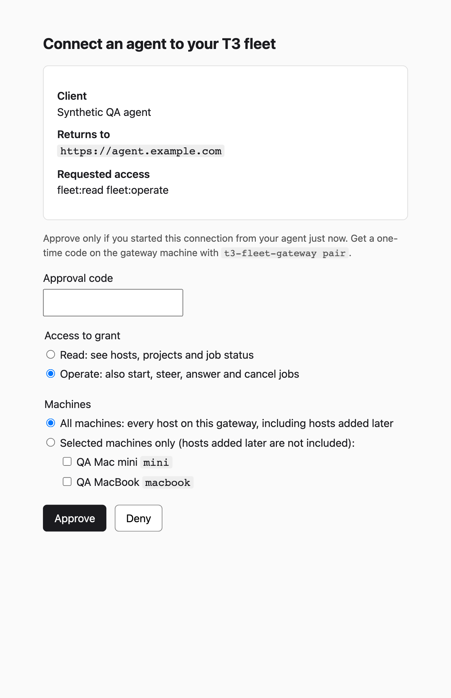
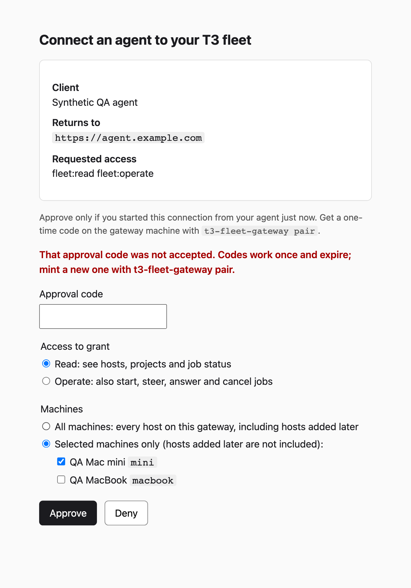
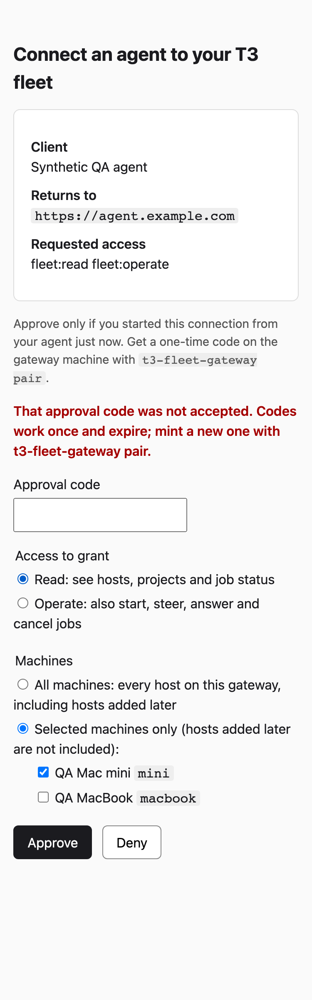

# v0.1.5 host access evidence

Captured against implementation commit `62b36b4`, using the real gateway OAuth and MCP endpoints with two **synthetic T3 hosts**. The MacBook below is a test fixture; the real M3 has not been enrolled or qualified by this check.

## Approval choices

All machines keeps the existing fleet-wide grant, including hosts added later. Existing OAuth and bearer connections retain that behavior.

Selected machines grants access only to the checked hosts. This capture selects Read on the mini only.

## Retry preserves the selection

After submitting an invalid synthetic approval code, the returned page retains Read and mini only. Correcting a code does not switch to All machines or Operate. The public OAuth regressions exercise the corrected-code submission and exact issued scopes.

The same retained selection at 375 CSS pixels, with no horizontal overflow:

## Access and compatibility checks

The separate fixture passed 20 assertions. Denied calls caused zero downstream operations on the other synthetic host. The [sanitized results](host-scopes-v015.json) contain outcomes only, without tokens, approval codes or worker content.

| Client grant | Mini | MacBook |
| --- | --- | --- |
| Existing fleet-wide OAuth | Read and operate | Read and operate |
| Existing fleet-wide bearer | Read and operate | Read and operate |
| Mini-only Operate | Read, start, steer, answer and cancel | Job reads and actions refused |
| Mini-only Read | Read | No access; mutations refused on either host |
| Mini-only after generic-scope refresh | Retains mini access | No new access |

`fleet_status`, job lists, feed events and attention omit the other host for the selected client. The feed cursor remains exclusive. Full messages and cross-client work on the permitted host remain available.

The test suite covers the public CLI, malformed choices, requested-scope ceilings, refresh rotation/grace/narrowing, standing jobs, idempotent replays and filtering before pagination. These screenshots and synthetic checks do not claim a live two-machine or hosted-client qualification.
