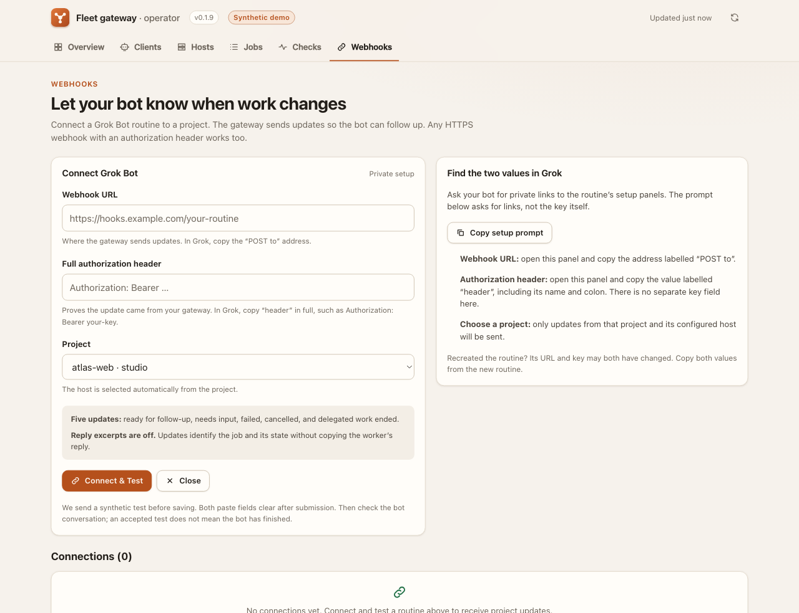
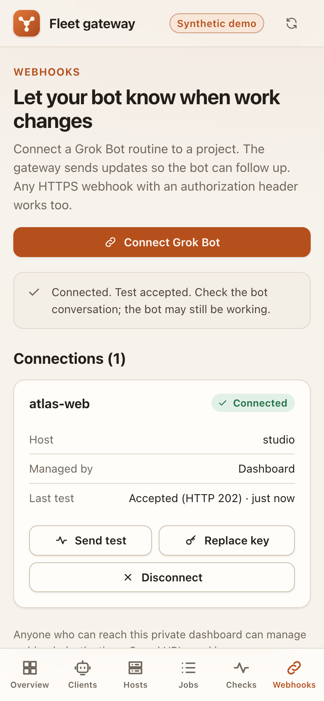

# Webhook connection setup verification

Verified on 2026-10-17 against implementation `30571cda98da0ee292906a17052d5741d6cb3004` (v0.1.9). All receivers, projects, credentials and jobs used here were synthetic. No real gateway configuration or hosted bot was used.

## Automated checks

- `npm run check`: typecheck passed; **473 tests in 83 suites**, all passed, none skipped.
- `npm run webhooks:smoke`: **29 checks passed** using actual HTTPS, public MCP, retries and process-crash recovery. See [webhook delivery evidence](webhooks.md).
- A separate private process/HTTPS harness: **56 assertions / 53 distinct checks**, four process starts and 12 authenticated HTTPS requests. The temporary CA, receiver, fake T3 hosts and gateway data were removed afterward. The public regression suite covers these management paths in `test/webhooks-management.test.ts`, `test/webhooks-management-cli.test.ts`, storage, dashboard UI and demo tests.

| Area | Observed result |
| --- | --- |
| First connection | With no webhook subscriptions in JSON, Connect sent a verified HTTPS ping, saved a dashboard-owned connection and woke delivery immediately. A completed scratch job arrived as an idle event. |
| Event contract | Project/host matched; feed cursor and sequence correlated with public `work_feed`; worker excerpts were absent by default. |
| Replace URL and key | A 503 response left the old revision and destination working. A successful replacement changed both URL and key; subsequent events went only to the new destination. |
| Restart | Dashboard-owned connection and replacement credentials survived restart without editing configuration. Sender resumed automatically; old browser session was refused. |
| CLI interoperability | Existing webhook list, attempts and ping commands worked for the dashboard-owned connection. |
| Disconnect and concurrency | Disconnect worked during a held replacement ping. The late successful ping could not resurrect the connection. Retried create/disconnect requests were idempotent; disconnected routes received no later job event and stayed absent after restart. |
| Shutdown | A held Connect ping was aborted and drained during graceful shutdown; no connection appeared on restart and no closed-database error occurred. |
| Request boundary | Missing/mismatched Origin, other allowlisted Origin, cross-site metadata, missing API header, Funnel, wrong Host, cleartext non-loopback Origin, insecure destination, header injection, unknown project/fields, oversized/malformed JSON and wrong content type were refused before delivery. No CORS approval; no management route on the public MCP listener. |
| Privacy | Dashboard results, gateway logs and CLI diagnostics contained no synthetic credential values, sensitive URL paths, task text or worker text. Payloads contained no authentication header. Configuration stayed byte-for-byte unchanged. |


The independent harness initially used Node fetch for a forged Host test; fetch normalized that header, so the harness was corrected to use raw HTTP. The successful run needed no product changes. Its inputs and results remained private; no credentials or machine-specific values are included here.

## Browser checks

The native collaborative browser exercised the actual dashboard and local demo receiver under a mounted `/t3-fleet-gateway/` path. Layouts were checked at desktop width and a 390-pixel phone viewport; this was responsive browser testing, not a physical iPhone test.

| Action | Observed result |
| --- | --- |
| Connect & Test | HTTP 202; exactly one connection; “Test accepted” and a prompt to check the bot conversation. |
| Copy fields across apps | Pasted URL survives returning after the dashboard's 60-second stale interval. An early implementation cleared it; the fix has a UI regression test and passed the browser retest. |
| Rejected replacement | HTTP 401; existing connection retained; subsequent Send test still accepted. |
| Successful replacement | “Connection updated”; one connection retained. |
| Disconnect | Keep connection cancels the confirmation; Yes, disconnect removes the connection. |
| Browser privacy | Paste fields clear after submission; saved URLs/headers absent from list; localStorage and sessionStorage remain empty. |
| Phone layout | Form, connection actions and navigation fit without horizontal overflow. |

Reproduce the interactive checks with:

```sh
npm run dashboard:demo -- --scenario healthy --port 0 --base-path /t3-fleet-gateway --webhook-receiver
```

Use only the printed fictional header and local `/accept`, `/reject` and `/timeout` endpoints. The demo refuses non-loopback webhook destinations. Stop it afterward to remove its temporary data.

### Actual demo screenshots





The [README walkthrough](../../README.md#give-your-bot-a-doorbell-) uses an illustrated field-mapping guide; these screenshots show the running implementation.

## Limits

A 2xx response establishes receiver acceptance, not completion of the hosted routine. A fresh Grok routine still needs its URL and full header pasted privately by the operator, followed by confirmation in the bot conversation. This evidence does not claim that hosted round trip or production deployment.
